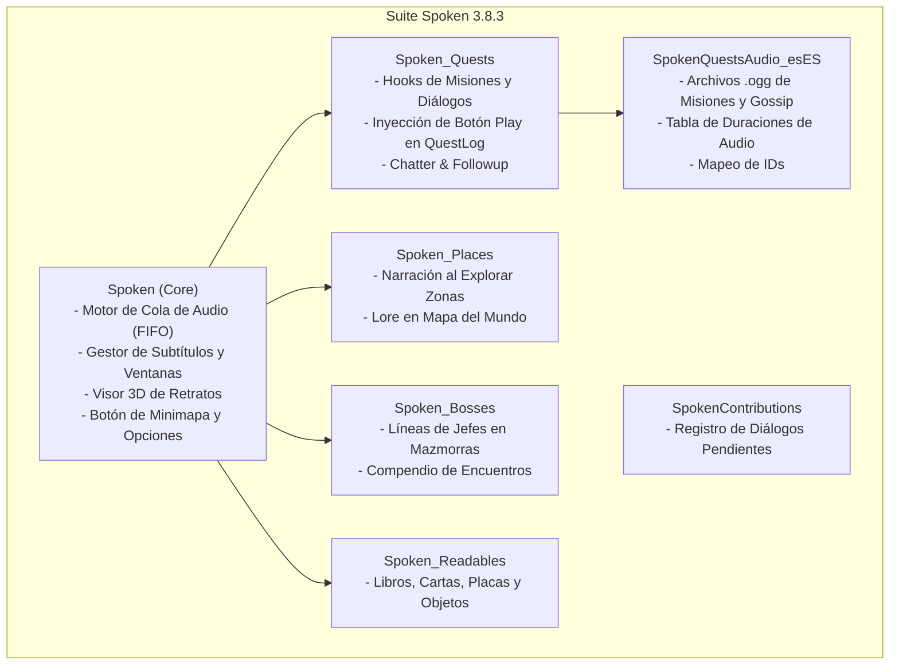
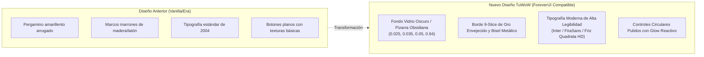

# Plan de Acción: Adaptación de Spoken (v3.8.3) para el Cliente TuWoW (WoW 3.3.5a + ForeverUI)

## 1. Resumen Ejecutivo y Diagnóstico

### 1.1. Propósito del Proyecto
Adaptar la suite completa de narración y doblaje de voz **Spoken (v3.8.3)** para que funcione de manera nativa, fluida y al 100% en el entorno híbrido de **TuWoW** (`Interface\AddOns`):
* **Motor base:** World of Warcraft 3.3.5a (Wrath of the Lich King, Build `12340`, `Interface: 30300`).
* **Capa visual y de experiencia:** **ForeverUI** (`ServerSystems/ForeverUI`), inspirada en interfaces modernas de Retail y Camelot.
* **Enfoque de contenido:** Azeroth Nivel 1-60 (Kalimdor y Reinos del Este), con modalidades de alta exigencia como **Hardcore / Die & Rise**.
* **Identidad estética requerida:** Renovación visual total hacia una apariencia pulcra, moderna, con paleta de fantasía oscura y oro envejecido (*TuWoW Dark Glass & Brushed Gold*), tipografías contemporáneas y nula interferencia con los marcos de ForeverUI.

---

### 1.2. Módulos que Integran la Suite Spoken


---

### 1.3. Diagnóstico de Incompatibilidades Técnicas (Spoken vs TuWoW 3.3.5a)

| Componente / API | Estado Actual en Spoken (Retail/Classic/Forever) | Realidad en TuWoW 3.3.5a | Solución Requerida |
| :--- | :--- | :--- | :--- |
| **Detección de Cliente** (`Version.lua`) | `Resolve(interface)` clasifica `interface >= 20000` como `"anniversary"` (TBC Anniversary moderno). | TuWoW reporta `INTERFACE_VERSION = 30300` (WotLK 3.3.5a). Tratarlo como moderno causa fallos de API. | Crear variante explícita `"tuwow"` / `"wotlk335"` con flags específicas. |
| **Archivos `.toc`** | `## Interface: 16001, 11509, 20506` con listas separadas por coma. | El cliente 3.3.5a solo acepta un valor entero: `## Interface: 30300`. Debe coincidir exactamente con el nombre de carpeta. | Normalizar todos los `.toc` a `30300`. |
| **Reproducción y Parada de Audio** (`SoundUtils.lua`) | `PlaySoundFile(path, channel)` esperando recibir `handle`, y `StopSound(handle)` para cortar. | En 3.3.5a, `PlaySoundFile` **no devuelve handle** y `StopSound(handle)` **no existe** para archivos personalizados. | Implementar polyfill de parada mediante **toggle instantáneo de canal CVar** (`SetCVar("Sound_EnableSFX", 0/1)`) y cronometrado vía `sound_length_table.lua`. |
| **Namespaces Modernos `C_*`** | Uso extensivo de `C_Timer.*`, `C_QuestLog.*`, `C_GossipInfo.*`, `C_Map.*`, `C_AddOns.*`. | Ninguno de estos namespaces existe de forma nativa en 3.3.5a. | Desplegar la capa modular `Compat335.lua` probada con éxito en `TuWoW_Leveling`. |
| **Plantilla `BackdropTemplate`** | `CreateFrame("Frame", nil, parent, "BackdropTemplate")` en `MinimalPlayer.lua` y widgets. | En 3.3.5a, los backdrops son nativos de `Frame`; `"BackdropTemplate"` genera errores de XML ausente. | Sanitizador automático de argumentos en `CreateFrame` para remover `"BackdropTemplate"`. |
| **Registro de Misiones** (`QuestOverlayUI.lua`) | Ancla botones al marco nativo `QuestLogFrame`. | ForeverUI oculta de inmediato `QuestLogFrame` y utiliza `ForeverUIQuestLogPanel` adosado al mapa. | Detectar ForeverUI e inyectar los botones de reproducción directamente en las filas de `ForeverUI.QuestLog`. |
| **Botón de Minimapa** (`MinimapButton.lua`) | `LibDBIcon-1.0` con radio y escala clásicos estándar. | ForeverUI aplica escala `1.414` al minimapa con radio exterior de `~100px`. El botón quedaría desfasado. | Sustituir o parchear la órbita con la fórmula matemática de compensación de `TuWoW_RareScan.Minimap.lua`. |
| **Zoom del Mapa del Mundo** (`Spoken_Places`) | Pines y resaltes calculados multiplicando por `GetScale()`. | `WorldMapZoom.lua` escala `WorldMapButton`. Multiplicar por escala desfasa los pines al hacer zoom. | Hacer los pines hijos directos de `WorldMapButton` con coordenadas relativas normalizadas (0 a 1). |

---

## 2. Nueva Identidad Visual: "TuWoW Dark Glass & Brushed Gold"

El usuario solicita una **apariencia pulcra, con otra paleta de colores y diferentes fuentes**, alejándose de los pergaminos amarillentos y cuadros toscos de las versiones previas.



### 2.1. Paleta Cromática y Materiales

```lua
SpokenTheme = {
    colors = {
        -- Fondos y paneles
        background     = { 0.025, 0.032, 0.048, 0.96 }, -- Pizarra obsidiana profunda
        panel          = { 0.045, 0.055, 0.078, 0.94 }, -- Capa media translúcida
        panelElevated  = { 0.070, 0.085, 0.115, 0.98 }, -- Elementos elevados / flotantes
        
        -- Acentos metálicos y bordes
        goldBright     = { 1.000, 0.820, 0.200, 1.00 }, -- Oro brillante (Títulos y activos)
        goldMid        = { 0.880, 0.700, 0.280, 1.00 }, -- Oro viejo cepillado (Bordes)
        goldDim        = { 0.450, 0.350, 0.160, 0.85 }, -- Oro tenue / divisores
        
        -- Jerarquía de texto
        textPrimary    = { 0.930, 0.910, 0.850, 1.00 }, -- Blanco marfil suave (Cuerpo de texto)
        textSecondary  = { 0.680, 0.700, 0.760, 1.00 }, -- Plata ceniza (Subtítulos, nombres)
        textMuted      = { 0.450, 0.480, 0.540, 1.00 }, -- Gris grafito (Duraciones, pistas)
        
        -- Resaltado karaoke y estados
        highlightWord  = { 1.000, 0.850, 0.300, 1.00 }, -- Oro resplandeciente en palabra activa
        cyanAccent     = { 0.350, 0.750, 1.000, 1.00 }, -- Cyan mágico (Lore / Lugares)
        danger         = { 0.950, 0.300, 0.250, 1.00 }, -- Alerta / combate
    },
    
    backdrops = {
        main = {
            bgFile = "Interface\\Buttons\\WHITE8X8",
            edgeFile = "Interface\\Tooltips\\UI-Tooltip-Border",
            tile = true, tileSize = 16, edgeSize = 12,
            insets = { left = 3, right = 3, top = 3, bottom = 3 },
        },
        card = {
            bgFile = "Interface\\Buttons\\WHITE8X8",
            edgeFile = "Interface\\Tooltips\\UI-Tooltip-Border",
            tile = true, tileSize = 16, edgeSize = 10,
            insets = { left = 2, right = 2, top = 2, bottom = 2 },
        },
    }
}
```

### 2.2. Tipografías Seleccionadas
Se integrarán tipografías modernas presentes en el cliente (`TuWoW_Leveling/Media/Fonts`) y fuentes maestras del cliente:
1. **Titulares y Nombres de Hablante:** `Friz Quadrata` (`Fonts\FRIZQT__.TTF`) o `FiraSans-SemiBold.ttf` en relieve dorado con sombra profunda.
2. **Cuerpo de Diálogo y Subtítulos:** `Inter-Medium.ttf` o `Inter-Regular.ttf` (proporciona legibilidad sin fatiga visual durante sesiones largas de leveo).
3. **Metadatos y Duraciones:** `Fonts\ARIALN.TTF` (Arial Narrow) o `FiraSans-Medium.ttf` para números compactos y limpios.

---

## 3. Plan de Arquitectura y Fases de Implementación

### Fase 1: Capa de Compatibilidad Universal 3.3.5a (`Compat335.lua`)
* **Objetivo:** Asegurar que todo el código de Spoken opere sin errores de Lua en el motor WotLK 3.3.5a.
* **Acciones:**
  1. Crear `Spoken/Compat335.lua` basado en la arquitectura sólida de `TuWoW_Leveling/Core/Compat335.lua`:
     - Implementar `C_Timer.After`, `C_Timer.NewTimer` y `C_Timer.NewTicker` sobre un único frame `OnUpdate`.
     - Polyfill para metatablas de Frames y Texturas: `SetColorTexture`, `SetShown`, `SetResizeBounds`, `SetAtlas`.
     - Sanitización de `"BackdropTemplate"` en llamadas a `CreateFrame`.
     - Shims para `C_AddOns`, `C_QuestLog`, `C_GossipInfo`, `C_Map`, `C_ChatInfo`.
     - Compatibilidad de grupos para 3.3.5a: `IsInRaid()`, `IsInGroup()`, `GetNumPartyMembers()`.
  2. Actualizar `Spoken/Version.lua` para resolver correctamente `INTERFACE_VERSION == 30300`:
     - Identificar la plataforma como `"tuwow"`.
     - Definir flags: `Version.IsTuWoW = true`, `Version.HasForeverUI = true`.
  3. Modificar todos los archivos `.toc` del ecosistema para fijar `## Interface: 30300`.

---

### Fase 2: Motor de Audio Adaptado a 3.3.5a (`SoundUtils.lua` & `SoundQueue.lua`)
* **Objetivo:** Resolver la ausencia de *sound handles* nativos en WotLK 3.3.5a, garantizando reproducción, pausa, salto (skip) y parada instantánea de clips de voz sin fugas de audio ni congelamientos.
* **Acciones:**
  1. **Control de Parada (Audio Cut):**
     - Al invocar `SoundUtils:StopSound()` o saltar un diálogo, ejecutar el ciclo de corte instantáneo:
       ```lua
       local channelCVar = CHANNEL_CVARS[channel] or "Sound_EnableSFX"
       SetCVar(channelCVar, 0)
       SetCVar(channelCVar, 1)
       ```
  2. **Cronometrado de Clips:**
     - En 3.3.5a, el cliente no notifica cuándo finaliza un archivo de sonido. Se usará la duración exacta provista por `sound_length_table.lua` en `SpokenQuestsAudio_esES`, gestionada con el temporizador `C_Timer.NewTimer()`.
  3. **Comportamiento en Combate (Modo Hardcore):**
     - Añadir opción `"Silenciar automáticamente al entrar en combate"` para priorizar alertas sonoras de peligro, aggro y mecánicas de supervivencia.

---

### Fase 3: Rediseño Visual de Frames de Reproducción y Subtítulos
* **Objetivo:** Transformar todos los marcos visuales de Spoken a la estética *TuWoW Dark Glass & Brushed Gold*.
* **Acciones:**
  1. Crear `Spoken/UI/Theme.lua` con la biblioteca centralizada de estilos, paletas y generadores de widgets (botones biselados, barras de progreso doradas, tarjetas con brillo al hover).
  2. **Rediseño de `MinimalPlayer.lua` (Ventana Compacta):**
     - Reemplazar el fondo de pergamino por el marco de vidrio oscuro obsidiana (`bgFile = WHITE8X8`, borde dorado fino).
     - Centrado y reiluminación del modelo 3D del NPC.
     - Controles de reproducción con botones circulares estilizados.
  3. **Rediseño de `Subtitle.lua` (Subtítulo Cinemático Flotante):**
     - Barra de subtítulos flotante con fondo oscuro translúcido y esquinas biseladas.
     - Tipografía `Inter` en blanco marfil con efecto de palabra activa resaltada en oro (`|cffffd10d`).
     - Posicionamiento por defecto por encima de `Y = 140` (respetando la barra inferior de ForeverUI).
  4. **Rediseño de `Actions.lua`:**
     - Botones de control con micro-texturas doradas y comportamiento hover fluido.

---

### Fase 4: Integración Nativa con ForeverUI
* **Objetivo:** Integrar Spoken a la perfección con los módulos específicos de `ServerSystems/ForeverUI`.
* **Acciones:**
  1. **Minimapa (`MinimapButton.lua`):**
     - Implementar la fórmula de compensación matemática de ForeverUI:
       ```lua
       local mapScale = (ForeverUI and ForeverUI.Minimap and Minimap and Minimap:GetScale()) or 1
       local radius = ((Minimap:GetWidth() * mapScale / 2) / mapScale) + 1
       local x = math.cos(angle) * radius
       local y = math.sin(angle) * radius
       btn:SetPoint("CENTER", Minimap, "CENTER", x, y)
       ```
     - Botón circular con el blasón de Spoken en oro y soporte para arrastre suave.
  2. **Registro de Misiones (`Spoken_Quests/QuestOverlayUI.lua`):**
     - Desacoplar de `QuestLogFrame` nativo (el cual ForeverUI oculta).
     - Enganchar (`hooksecurefunc`) con `ForeverUI.QuestLog` y acoplar el botón interactivo de "Reproducir Diálogo" en las entradas del panel lateral de misiones.
  3. **Mapa del Mundo (`Spoken_Places/UI/MapPanel.lua`):**
     - Anclar elementos como hijos de `WorldMapButton` usando coordenadas normalizadas para evitar desfasajes durante el zoom con rueda de ratón de `WorldMapZoom.lua`.

---

### Fase 5: Adaptación de Submódulos y Contenido 1-60
* **Objetivo:** Verificar y afinar cada submódulo para Azeroth Clásico en español.
* **Acciones:**
  1. **`SpokenQuestsAudio_esES`:**
     - Asegurar la carga bajo demanda (`LoadOnDemand: 1`) con registro en `VoiceOver.DataModules`.
     - Validar que las rutas `generated\sounds\quests\` y `generated\sounds\gossip\` se resuelvan sin problemas en Windows.
  2. **`Spoken_Bosses`:**
     - Garantizar la cobertura de todas las mazmorras clásicas de nivel 1-60 (Minas de la Muerte, Cuevas de los Lamentos, Monasterio Escarlata, Stratholme, etc.).
  3. **`Spoken_Places`:**
     - Confirmar que los triggers de zonas y subzonas de Kalimdor y Reinos del Este reproduzcan la narración histórica correspondiente al entrar.
  4. **`Spoken_Readables`:**
     - Integrar la narración para los libros y cartas del juego sin romper la interfaz de lectura clásica de 3.3.5a.

---

### Fase 6: Pruebas, Verificación y Despliegue en TuWoW
* **Objetivo:** Comprobación rigurosa en el cliente de juego real.
* **Acciones:**
  1. Instalar la suite en `C:\TuWoW\TuWoW-Client\Interface\AddOns`.
  2. Verificar que no existan errores de sintaxis en el registro de Lua (`Errors/` o mensaje en chat).
  3. Probar la apertura de misiones con NPCs clásicos (ej. misiones de inicio humanas/orcas) y comprobar sincronía de audio y subtítulo.
  4. Probar interacciones con el minimapa y mapa del mundo con zoom activo.

---

## 4. Matriz de Componentes Visuales

| Componente | Apariencia Original | Nueva Apariencia TuWoW | Ventajas |
| :--- | :--- | :--- | :--- |
| **Fondo Principal** | Textura de pergamino amarillo o piedra básica | Vidrio obsidiana / Pizarra translúcida (`0.025, 0.035, 0.05, 0.94`) | Alta inmersión, reduce cansancio visual y combina con ForeverUI. |
| **Bordes** | Borde de madera estándar o bisel grueso de 2004 | Borde sutil en oro forjado (`UI-Tooltip-Border` / filigrana) | Estilo cinemático contemporáneo similar a Retail/Dragonflight. |
| **Tipografía de Diálogo** | Friz Quadrata básica o fuente del sistema | `Inter-Medium` / `FiraSans` nítida con sombra suave | Lectura ultra fluida de diálogos largos. |
| **Subtítulos** | Fondo rectangular negro opaco | Cápsula flotante semitransparente con halo dorado reactivo | No tapa la pantalla ni la acción de combate/leveo. |
| **Botones de Control** | Texturas clásicas de Blizzard | Botones circulares con anillo de oro y glow al pasar el ratón | Estética premium y tacto moderno. |

---

## 5. Preguntas Clave y Puntos de Decisión para el Usuario

Antes de comenzar a ejecutar la Fase 1, te planteo estas decisiones de diseño:

1. **Modo de visualización por defecto:**
   * ¿Prefieres que por defecto Spoken aparezca como **Subtítulo cinemático flotante** (estilo película en la parte inferior-central) o como **Ventana compacta con retrato 3D** (*MinimalPlayer*) a un lado? (Ambos se podrán alternar desde opciones).
2. **Tipografía principal:**
   * ¿Deseas utilizar la fuente moderna **Inter-Medium** (máxima legibilidad) o mantener **Friz Quadrata HD** (el clásico tono épico de WoW)?
3. **Comportamiento en Combate (Modo Hardcore):**
   * ¿Te gustaría que al entrar en combate se silencie/pause automáticamente cualquier narración activa para que no interfiera con los avisos sonoros de supervivencia?

